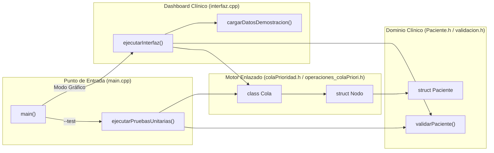

# MediPriority — Emergency Triage & Patient Prioritization System

[]()
[]()
[]()
[]()
[-critical.svg)]()

**MediPriority** es un sistema clínico de clasificación (Triage) y despacho de pacientes para salas de emergencias hospitalarias desarrollado íntegramente en **C++17** con interfaz gráfica acelerada por hardware en **Dear ImGui + OpenGL3**.

El motor de priorización implementa una **Cola de Prioridad Dinámica Enlazada (`Cola<T>`)** construida desde cero mediante gestión manual de punteros y memoria dinámica (`Nodo<T>`), prescindiendo por completo de contenedores especializados de la STL (`std::priority_queue`, `std::vector`, `std::list` o `<algorithm>`) para garantizar control algorítmico total, estabilidad **FIFO** en empates de urgencia e inspección directa de direcciones de memoria en tiempo real.

---

## Tabla de Contenidos

1. [Resumen Ejecutivo y Capacidades](#1-resumen-ejecutivo-y-capacidades)
2. [Escala Clínica de Triage (Niveles 1 al 5)](#2-escala-clínica-de-triage-niveles-1-al-5)
3. [Arquitectura del Sistema y Estructura del Repositorio](#3-arquitectura-del-sistema-y-estructura-del-repositorio)
4. [Complejidad Algorítmica y Regla de Desempate FIFO](#4-complejidad-algorítmica-y-regla-de-desempate-fifo)
5. [Guía de Inicialización, Compilación y Ejecución (Para Evaluación Docente)](#5-guía-de-inicialización-compilación-y-ejecución-para-evaluación-docente)
6. [Verificación Automatizada (Suite de Pruebas Unitarias)](#6-verificación-automatizada-suite-de-pruebas-unitarias)
7. [Grafo de Conocimiento del Proyecto](#7-grafo-de-conocimiento-del-proyecto)
8. [ Flujo de Trabajo y Créditos del Equipo](#8-flujo-de-trabajo-y-créditos-del-equipo)

---

## 1. Resumen Ejecutivo y Capacidades

En una unidad de urgencias hospitalarias, el orden de atención no puede regirse por una cola simple *First-In, First-Out (FIFO)* pura, ya que un paciente con compromiso vital requiere intervención inmediata por encima de consultas ambulatorias registradas previamente.

**MediPriority v1.0.0** resuelve este problema integrando:

* **Motor de Cola de Prioridad Dinámica (`Cola<T>`):** Lista simplemente enlazada ordenada por nivel de prioridad (`1` a `5`) con inserción posicional estable (`strict <`), preservando el orden cronológico de llegada (**FIFO**) entre pacientes del mismo nivel de urgencia.
* **Dashboard Clínico Animado (Material Design 3 + Dear ImGui / OpenGL3):**
  * **Diseño Clínico Moderno y Animaciones Fluidas (`easeOutCubic`):** Icono clínico vectorial con pulso en vivo, superficies limpias de alto contraste (`#F7F9FC` / `#FFFFFF`), sombras proyectadas con elevación dinámica al pasar el cursor (*hover elevation*), entrada animada en cascada (*stagger*) de tarjetas de nodos, conectores de punteros `sig*` con partículas animadas en tiempo real y selector instantáneo **`Tema: Claro / Oscuro`**.
  * **Indicadores KPI en Tiempo Real:** Contadores instantáneos en la cabecera para cada nivel de prioridad (`N1` a `N5`), pacientes en espera, pacientes atendidos y contador de operaciones de punteros.
  * **Formulario de Admisión con Validación Clínica:** Verificación estricta de nombres alfabéticos, rango etario (`1 - 120` años), cuadro clínico obligatorio, chips rápidos de prioridad y previsualización en vivo de la posición exacta donde se insertará el paciente en la estructura enlazada.
  * **Box Médico en Atención:** Panel de estado activo que muestra al último paciente despachado (`desencolarConPrioridad`), su ticket `#ID`, hora de ingreso y prioridad clínica, además del próximo paciente en `frente`.
  * **Visualizador Gráfico de Nodos Enlazados:** Representación horizontal con scroll de tarjetas conectadas mediante punteros (`sig -->`) hasta `sig -> NULL`, con escalamiento dinámico de prioridad (`^ Subir Urgencia`) ante empeoramiento clínico y retiro individual (`Retirar`).
  * **Inspector de Memoria Física (`Nodo*` y `sig*`):** Vista conmutable a tabla técnica que expone las direcciones hexadecimales reales en memoria RAM de cada nodo y su puntero `siguiente`.
  * **Simulador Clínico Integrado:** Botón `Cargar Demo (6)` que inserta un lote realista de pacientes con prioridades mezcladas y empates para auditar el reordenamiento automático en un solo clic.

---

## 2. Escala Clínica de Triage (Niveles 1 al 5)

El sistema adopta el estándar internacional de clasificación hospitalaria de 5 niveles (basado en el * Emergency Severity Index - ESI* y el *Sistema Español de Triaje*):

| Prioridad | Categoría Clínica | Color | Tiempo Objetivo | Criterio de Ubicación en `Cola<Paciente>` |
| :---: | :--- | :--- | :---: | :--- |
| **1** | **Resucitación (Crítico)** | Rojo | Inmediato | Se inserta delante de prioridades `2, 3, 4, 5` (al final de otros `P1`). |
| **2** | **Emergencia** | Naranja | < 10 - 15 min | Se inserta detrás de `P1` y delante de `P2` posteriores, `P3, P4, P5`. |
| **3** | **Urgencia** | Amarillo | < 30 - 60 min | Se inserta detrás de `P1, P2` y delante de `P4, P5`. |
| **4** | **Urgencia Menor** | Verde | < 120 min | Se inserta detrás de `P1, P2, P3` y delante de `P5`. |
| **5** | **No Urgente** | Azul | < 240 min | Se ubica al final de la cola enlazada. |

---

## 3. Arquitectura del Sistema y Estructura del Repositorio

El código separa estrictamente la lógica de datos y validación respecto del mecanismo de entrega visual (GUI):

```text
emergency-triage-minheap/
├── CMakeLists.txt                   # Configuración multiplataforma CMake (32/64 bits)
├── ColasPrioridad.cbp               # Proyecto configurado para Code::Blocks IDE
├── compilar_y_ejecutar.bat          # Script automatizado de compilación y arranque en 1 clic
├── README.md                        # Documentación principal y guía de inicialización
├── docs/
│   ├── SPEC-triage-system.md        # Especificación técnica y modelo de datos
│   ├── GUIA-DE-PRUEBAS-Y-DEFENSA.md # Guía paso a paso para sustentación y defensa académica
│   └── decisions/
│       └── ADR-001-custom-min-heap.md # Registro de decisión arquitectónica (Estructura enlazada)
├── graphify-out/
│   ├── GRAPH_REPORT.md              # Reporte estructural del grafo de conocimiento del proyecto
│   ├── graph.html                   # Visualizador interactivo del grafo de arquitectura
│   └── graph.json                   # Grafo serializado de nodos y relaciones
├── fonts/
│   ├── Inter-Regular.ttf            # Tipografía clínica principal
│   └── Inter-Bold.ttf               # Tipografía para cabeceras e indicadores
├── external/
│   ├── imgui/                       # Motor gráfico Dear ImGui + Backends OpenGL3 / GLFW / Win32
│   └── glfw-3.5.1.bin.WIN64/        # Cabeceras y binarios GLFW para entornos de 64 bits
└── src/
    ├── main.cpp                     # Punto de entrada dual (GUI por defecto + CLI --test / --help)
    ├── Paciente.h                   # Entidad clínica Paciente (ID autoincremental, timestamp, datos)
    ├── validacion.h                 # Reglas de validación de entrada y sanitización alfabética
    ├── colaPrioridad.h              # Declaración de plantillas Nodo<T> y Cola<T>
    ├── operaciones_colaPriori.h     # Implementación de algoritmos de encolado, desencolado y punteros
    ├── interfaz.h                   # Contrato del módulo de presentación gráfica
    └── interfaz.cpp                 # Implementación del Dashboard Clínico en Dear ImGui + OpenGL3
```

---

## 4. Complejidad Algorítmica y Regla de Desempate FIFO

La estructura `Cola<T>` definida en [`src/colaPrioridad.h`](src/colaPrioridad.h) e implementada en [`src/operaciones_colaPriori.h`](src/operaciones_colaPriori.h) utiliza nodos dinámicos enlazados:

```cpp
template <typename T>
struct Nodo {
    T dato;
    int prioridad;
    Nodo<T>* siguiente;
};
```

### Garantía de Desempate Cronológico (FIFO)
Al invocar `encolar(const T& valor, int prioridad)`, el puntero auxiliar recorre la lista mediante la condición estricta:
```cpp
while (actual->siguiente != nullptr && actual->siguiente->prioridad <= prioridad) {
    actual = actual->siguiente;
}
```
El operador **`<=`** garantiza que el nuevo nodo avance hasta superar a todos los nodos previamente registrados con **mayor o igual urgencia**, insertándose inmediatamente después del último paciente de su misma prioridad y antes del primer paciente con prioridad numérica mayor (menor urgencia).

| Operación | Método en `Cola<T>` | Complejidad Temporal | Complejidad Espacial |
| :--- | :--- | :---: | :---: |
| **Atender siguiente paciente** | `desencolar()` / `desencolarConPrioridad()` | $O(1)$ | $O(1)$ |
| **Consultar próximo en turno** | `consultarFrente()` / `consultarFrenteConPrioridad()` | $O(1)$ | $O(1)$ |
| **Registrar nuevo paciente** | `encolar(valor, prioridad)` | $O(N)$ | $O(1)$ |
| **Escalar prioridad clínica** | `actualizarPrioridad(pos, nuevaPrioridad)` | $O(N)$ | $O(1)$ |
| **Retirar paciente específico** | `eliminarEnPosicion(pos, salida)` | $O(N)$ | $O(1)$ |
| **Inspección de punteros RAM** | `obtenerDireccionNodo(pos)` / `obtenerDireccionSiguiente(pos)` | $O(N)$ | $O(1)$ |

---

## 5. Guía de Inicialización, Compilación y Ejecución (Para Evaluación Docente)

El repositorio es **100% autocontenido** (incluye fuentes tipográficas `Inter`, motor `Dear ImGui` y cabeceras/binarios necesarios en `external/`). Además, cuenta con **detección automática de arquitectura (`32 bits` y `64 bits`)**, por lo que compila sin configuraciones adicionales en cualquier PC con Windows y MinGW (`g++`).

### Pasos para Clonar y Ejecutar desde la PC del Docente

```powershell
git clone https://github.com/xavieraimacana/emergency-triage-minheap.git
cd emergency-triage-minheap
.\compilar_y_ejecutar.bat
```

### Opción A — Inicio Rápido en 1 Clic (`compilar_y_ejecutar.bat`)

Haga doble clic sobre [`compilar_y_ejecutar.bat`](compilar_y_ejecutar.bat) en el Explorador de Windows o ejecútelo desde la terminal. El script detecta automáticamente el compilador `g++` instalado en la PC (ya sea en `PATH`, `C:\MinGW\bin`, `C:\msys64\mingw64\bin` o `C:\Program Files\CodeBlocks\MinGW\bin`), compila el sistema y abre la interfaz gráfica:

```powershell
.\compilar_y_ejecutar.bat
```

### Opción B — Compilación Manual por Línea de Comandos (`g++` MinGW)

1. **Con MinGW de 32 bits (`C:\MinGW\bin\g++.exe`):**
   ```powershell
   g++ -std=c++17 -O2 -Isrc -Iexternal/imgui -Iexternal/imgui/backends src/main.cpp src/interfaz.cpp external/imgui/imgui.cpp external/imgui/imgui_draw.cpp external/imgui/imgui_tables.cpp external/imgui/imgui_widgets.cpp external/imgui/backends/imgui_impl_win32.cpp external/imgui/backends/imgui_impl_opengl3.cpp -o MediPriority.exe -lopengl32 -lgdi32 -luser32 -limm32
   .\MediPriority.exe
   ```

2. **Con MinGW-w64 de 64 bits:**
   ```powershell
   g++ -std=c++17 -O2 -Isrc -Iexternal/imgui -Iexternal/imgui/backends -Iexternal/glfw-3.5.1.bin.WIN64/include src/main.cpp src/interfaz.cpp external/imgui/imgui.cpp external/imgui/imgui_draw.cpp external/imgui/imgui_tables.cpp external/imgui/imgui_widgets.cpp external/imgui/backends/imgui_impl_glfw.cpp external/imgui/backends/imgui_impl_opengl3.cpp external/glfw-3.5.1.bin.WIN64/lib-mingw-w64/libglfw3.a -o MediPriority.exe -lopengl32 -lgdi32 -luser32 -lshell32 -limm32
   .\MediPriority.exe
   ```

### Opción C — Compilación con CMake

```powershell
cmake -B build -DCMAKE_BUILD_TYPE=Release
cmake --build build --config Release
.\build\MediPriority.exe
```

### Opción D — Apertura en Code::Blocks IDE

1. Abrir el archivo [`ColasPrioridad.cbp`](ColasPrioridad.cbp) desde **Code::Blocks**.
2. Presionar **F9 (Build and Run)**.

---

## 6. Verificación Automatizada (Suite de Pruebas Unitarias)

El ejecutable incorpora un modo de auditoría por consola que verifica la inserción por prioridad, el desempate FIFO, la actualización dinámica de prioridad y las reglas de validación clínica sin requerir intervención manual:

```powershell
.\MediPriority.exe --test
```

Salida esperada:
```text
===================================================================
  SUITE DE PRUEBAS UNITARIAS - COLA DE PRIORIDAD Y TRIAGE CLINICO  
===================================================================
  [PASS] 1. Ordenamiento por prioridad + desempate FIFO
  [PASS] 2. Reubicacion dinamica al subir urgencia clinica
  [PASS] 3. Validacion clinica y sanitizacion de entradas
===================================================================
  RESULTADO FINAL: TODAS LAS PRUEBAS PASARON EXITOSAMENTE (100%)
===================================================================
```

---

## 7. Grafo de Conocimiento del Proyecto

La arquitectura completa fue auditada y mapeada en [`graphify-out/GRAPH_REPORT.md`](graphify-out/GRAPH_REPORT.md) y [`graphify-out/graph.html`](graphify-out/graph.html) (**120 nodos, 192 relaciones y 8 comunidades cohesivas**):



---

## 8. Flujo de Trabajo y Créditos del Equipo

| Integrante | Rol y Módulos Desarrollados |
| :--- | :--- |
| **Anthony Aimacaña** (`@xavieraimacana`) | Arquitectura general, integración de subsistemas, Dashboard Clínico avanzado (KPIs, Box Médico, Inspector de Punteros RAM, Simulador Demo), compatibilidad dual Win32/GLFW, suite de pruebas unitarias y documentación técnica. |
| **Mateo Soto** (`@MateoS`) | Diseño e implementación de la estructura dinámica `Nodo<T>` y `Cola<T>` (`colaPrioridad.h`, `operaciones_colaPriori.h`). |
| **Alejandro Rivadeneira** | Modelado de la entidad `Paciente`, reglas de validación (`validacion.h`) y estructura base de interfaz gráfica (`interfaz.h`, `interfaz.cpp`). |
