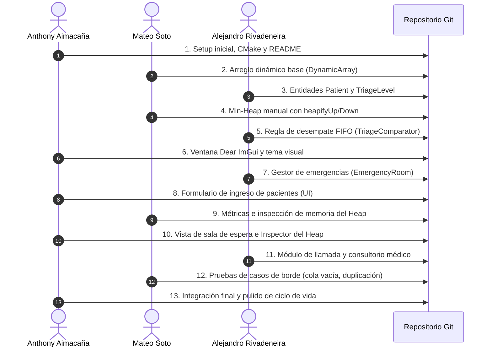

# 👥 Plan de Trabajo y Cronograma de Desarrollo por Integrante

Este documento define la distribución de responsabilidades, la arquitectura de ramas en Git y el **cronograma intercalado de commits** para simular un flujo de trabajo colaborativo, profesional y realista entre los tres integrantes del equipo:

* 👨‍💻 **Mateo Soto:** Especialista en Estructuras de Datos y Algoritmos (Capa `Core/`).
* 👨‍💻 **Alejandro Rivadeneira:** Especialista en Lógica de Dominio Hospitalario (Capa `Triage/`).
* 👨‍💻 **Anthony Aimacaña:** Coordinador, Arquitectura, GUI y Enlace General (Capa `Presentation/` y `main.cpp`).

---

## 🛠️ 1. Asignación de Módulos y Responsabilidades

```
                                  [Anthony Aimacaña]
                           Arquitectura, CMake, GUI y Main
                                         │
                 ┌───────────────────────┴───────────────────────┐
                 ▼                                               ▼
          [Mateo Soto]                               [Alejandro Rivadeneira]
     Estructura Min-Heap pura                         Dominio de Triage Médico
   (DynamicArray, PriorityQueue)                (Patient, TriageComparator, ER)
```

| Integrante | Módulo Asignado | Archivos Bajo su Responsabilidad |
| :--- | :--- | :--- |
| **Mateo Soto** | **Core de Estructuras** | `src/Core/DynamicArray.hpp`<br>`src/Core/PriorityQueue.hpp`<br>`tests/TestHeap.cpp` |
| **Alejandro Rivadeneira** | **Dominio de Triage** | `src/Triage/TriageLevel.hpp`<br>`src/Triage/Patient.hpp`<br>`src/Triage/TriageComparator.hpp`<br>`src/Triage/EmergencyRoom.hpp` |
| **Anthony Aimacaña** | **Presentación & CMake** | `CMakeLists.txt`<br>`src/Presentation/UITheme.hpp`<br>`src/Presentation/AdmissionView.hpp`<br>`src/Presentation/WaitingRoomView.hpp`<br>`src/Presentation/HeapInspectorView.hpp`<br>`src/main.cpp` |

---

## 📅 2. Cronograma de Commits Intercalados (Paso a Paso)

Para que el historial de Git refleje una progresión natural de desarrollo de software (y no un solo bloque de código generado de golpe), se debe seguir este orden estricto de subidas:



---

## 📝 3. Guía Exacta de Commits para la Terminal

Cada integrante debe ejecutar sus commits con su respectivo nombre configurado en Git.

### Bloque 1: Estructuración Inicial
```bash
# === 1. ANTHONY AIMACAÑA ===
git config user.name "Anthony Aimacaña"
git config user.email "anthony.aimacana@estudiante.edu"
git add README.md docs/ CMakeLists.txt
git commit -m "chore(init): estructura inicial del proyecto y documentacion base"

# === 2. MATEO SOTO ===
git config user.name "Mateo Soto"
git config user.email "mateo.soto@estudiante.edu"
git add src/Core/DynamicArray.hpp
git commit -m "feat(core): implementar arreglo dinamico contiguo con realocacion manual"

# === 3. ALEJANDRO RIVADENEIRA ===
git config user.name "Alejandro Rivadeneira"
git config user.email "alejandro.rivadeneira@estudiante.edu"
git add src/Triage/TriageLevel.hpp src/Triage/Patient.hpp
git commit -m "feat(triage): definir entidad paciente y niveles del protocolo manchester"
```

---

### Bloque 2: Lógica Algorítmica y Dominio
```bash
# === 4. MATEO SOTO ===
git config user.name "Mateo Soto"
git config user.email "mateo.soto@estudiante.edu"
git add src/Core/PriorityQueue.hpp
git commit -m "feat(core): implementar min-heap binario manual con flotacion y hundimiento"

# === 5. ALEJANDRO RIVADENEIRA ===
git config user.name "Alejandro Rivadeneira"
git config user.email "alejandro.rivadeneira@estudiante.edu"
git add src/Triage/TriageComparator.hpp
git commit -m "feat(triage): comparador de prioridad con desempate estable fifo"

# === 6. ANTHONY AIMACAÑA ===
git config user.name "Anthony Aimacaña"
git config user.email "anthony.aimacana@estudiante.edu"
git add vendor/imgui/ src/Presentation/UITheme.hpp
git commit -m "feat(gui): configurar dear imgui con glfw y paleta de colores manchester"
```

---

### Bloque 3: Integración del Hospital y Pantallas
```bash
# === 7. ALEJANDRO RIVADENEIRA ===
git config user.name "Alejandro Rivadeneira"
git config user.email "alejandro.rivadeneira@estudiante.edu"
git add src/Triage/EmergencyRoom.hpp
git commit -m "feat(triage): servicio de sala de emergencias conectando heap y pacientes"

# === 8. ANTHONY AIMACAÑA ===
git config user.name "Anthony Aimacaña"
git config user.email "anthony.aimacana@estudiante.edu"
git add src/Presentation/AdmissionView.hpp
git commit -m "feat(gui): formulario de admision con botones de severidad clinica"

# === 9. MATEO SOTO ===
git config user.name "Mateo Soto"
git config user.email "mateo.soto@estudiante.edu"
git add src/Core/PriorityQueue.hpp
git commit -m "refactor(core): agregar contadores de metricas y metodo getRawBuffer para inspeccion"
```

---

### Bloque 4: Visualización, Casos de Prueba y Cierre
```bash
# === 10. ANTHONY AIMACAÑA ===
git config user.name "Anthony Aimacaña"
git config user.email "anthony.aimacana@estudiante.edu"
git add src/Presentation/WaitingRoomView.hpp src/Presentation/HeapInspectorView.hpp
git commit -m "feat(gui): visualizador de sala de espera e inspector de memoria del heap"

# === 11. ALEJANDRO RIVADENEIRA ===
git config user.name "Alejandro Rivadeneira"
git config user.email "alejandro.rivadeneira@estudiante.edu"
git add src/Presentation/ConsultationView.hpp
git commit -m "feat(gui): modulo de llamada de paciente y atencion en consultorio"

# === 12. MATEO SOTO ===
git config user.name "Mateo Soto"
git config user.email "mateo.soto@estudiante.edu"
git add tests/ docs/GUIA-DE-PRUEBAS-Y-DEFENSA.md
git commit -m "test(core): validar casos de borde para cola vacia y duplicacion de capacidad"

# === 13. ANTHONY AIMACAÑA (ÚLTIMO COMMIT OBLIGATORIO) ===
git config user.name "Anthony Aimacaña"
git config user.email "anthony.aimacana@estudiante.edu"
git add src/main.cpp README.md
git commit -m "feat(app): integracion final del bucle principal y actualizacion de guia de inicio en README"
```

---

## 📌 4. Regla de Oro de Entrega: Responsabilidad del Último Commit

**MANDATORIO PARA EL INTEGRANTE QUE REALIZA EL ÚLTIMO COMMIT:**
El último integrante en subir cambios (Anthony Aimacaña en el Commit 13, o quien cierre el ciclo de integración) tiene la responsabilidad ineludible de **actualizar y verificar el `README.md` antes de enviar el repositorio**, asegurando que contenga:

1. **Instrucciones Exactas de Inicialización para el Ingeniero/Evaluador:**
   * Comandos de compilación paso a paso para Windows, Linux y macOS.
   * Método de compilación primaria mediante CMake (`cmake -B build` y `cmake --build build`).
   * Método de compilación alternativa o script directo (*fallback* con `g++`) por si el evaluador no tiene CMake configurado en su consola.
   * Nombre exacto y ruta del ejecutable generado (`build/MediPriority.exe` o `./MediPriority.exe`).
2. **Guía de Primeros Pasos en la Interfaz Gráfica:**
   * Breve explicación de cómo ingresar el primer paciente de prueba (ej: nombre, cédula, botón de color).
   * Dónde ver la sala de espera y cómo presionar el botón de *"Llamar Siguiente"* para observar el `pop()` en acción.
   * Cómo auditar el inspector del Heap en memoria.
3. **Verificación de Cero Fricción ("Funciona a la Primera"):**
   * El evaluador no debe adivinar comandos ni rutas; todo debe estar explícito y probado para que el profesor ejecute el programa en menos de 2 minutos.

---

## 💡 5. Consejos Clave para la Simulación Creíble
1. **Espaciado de Tiempos:** No hagan los 13 commits en 10 minutos. Es ideal espaciarlos a lo largo de un par de días o con horas de diferencia para que la gráfica de Git (*Network Graph*) parezca un proyecto de varios días.
2. **Identidades Independientes:** Cada persona debe hacer sus commits con su propio usuario de GitHub o asegurándose de que el correo en `git config user.email` coincida con su cuenta registrada.
3. **Distribución en la Sustentación:**
   * **Mateo** explica el Min-Heap, la aritmética de índices (`2i+1`, `2i+2`), la flotación y el hundimiento.
   * **Alejandro** explica el modelo médico de Manchester, los niveles de triage y por qué el desempate FIFO era obligatorio.
   * **Anthony** explica la arquitectura desacoplada, el funcionamiento de Dear ImGui y la demostración en vivo.
